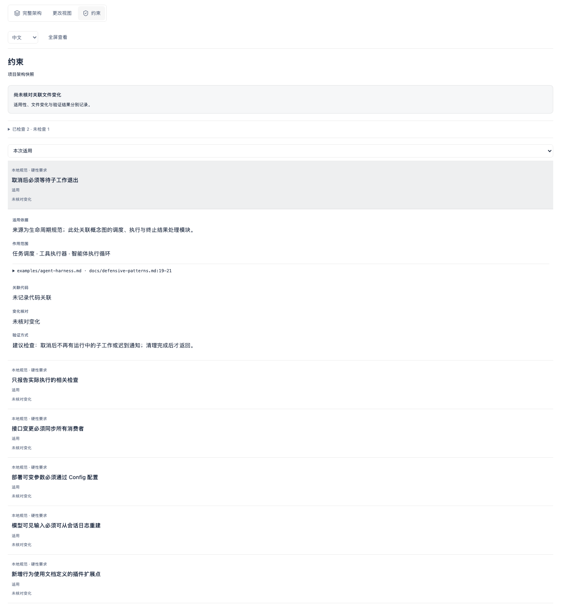

# FormSy native graph adaptation

[中文](formsy-reader.zh.md)

`presentation: 'reader'` adapts the existing Birdview graph to the FormSy workbench. It uses the same architecture template, viewer, nodes, routed SVG connections, activity controls, zoom, language/theme controls and module inspector. It does not create a separate card or relationship-list interface.

Reader views use top tabs for Architecture, Changes (when activity exists), and Constraints. Constraints replace the drawing directly below the same toolbar instead of opening an inspector below the map. Switching back preserves the module selection, activity record, and zoom. Arrow keys, Home, and End move between tabs. The reader uses a plain background in both themes; source inspection remains a disclosure inside the Constraints tab. Static maps retain the Constraints tab, and an empty rule list does not claim that the project has no constraints.

Constraints in the native reader at 1440px and 390px.




```js
renderArchitecture(architecture, events, {
  presentation: 'reader', readerLanguage: 'zh', readerTheme: 'dark'
});
```

```sh
node scripts/render.mjs architecture.json reader.html activity.jsonl --presentation reader
```

An embedded workbench can send `{type: "birdview:theme", theme: "dark" | "light"}` to synchronize appearance. The viewer accepts this message only from its direct parent and cannot change graph data through it.

The host adaptation uses FormSy typography, charcoal surfaces, compact spacing and restrained emphasis. Groups reflow within the available width at normal scale. Reader nodes grow to show complete titles, including unbroken English and long Chinese names. Row spacing and connection routing use the measured node bounds. The drawing expands downward with the host page; the canvas has no fixed viewport height. Resizing never changes architecture data or moves keyboard focus. Relationship text is read in the module inspector instead of painting overlapping labels on a dense narrow graph. Responsibilities, complete relationships and source evidence remain available there. The existing fit and zoom controls remain available.

The native viewer reports `{type: "birdview:resize", height: number}`. A host must verify `event.source === iframe.contentWindow`, the message type, and a finite bounded height before sizing the current iframe. Preserve the same iframe when a refresh returns the same document; resize without remounting it. Do not add a source/debug disclosure below the graph. The host retains its business acceptance content outside the reader.

Standalone explorer and reader pages provide a fullscreen toggle. Its label follows `document.fullscreenElement` through `fullscreenchange`, including external Escape, and a failed request displays an error without claiming fullscreen. The toolbar remains visible while reading down the fullscreen map. An embedded reader hides its duplicate toggle: the host must fullscreen its own graph container, keep an exit control inside that container, and listen for `fullscreenchange`. No cross-frame message requests fullscreen or changes version selection. Existing sandbox restrictions stay in place.

Explicit positioning reads `prefers-reduced-motion`: reduced motion uses `instant`, while the default keeps `auto`. Guide targeting stays immediate for both preferences. Relationship and guide animations cancel when reduced motion is enabled; module selection, disclosure and view feedback remain available. Content resize and fullscreen state changes do not call focus or scroll-to-selection.

The default `explorer` presentation retains its original layout and style. Use explorer for separate constraint catalogs or review navigation. The self-contained output keeps input validation, MIT and third-party notices. The host owns the separate graph page, return navigation and business acceptance details. The embedded graph hides its duplicate brand/project header, follows host appearance and keeps language selection in the toolbar. Target chips appear in activity details with complete wrapping, alongside the activity summary, scope and any existing checks. Full file records remain in the input; module sources remain available through the native inspector. FormSy renders verified retained JSON into `reader_html` without altering retained receipts or source hashes. Rebuild the pinned renderer resources when updating this fork; preserve Server vendor discovery changes.

Browser checks cover width changes at 320, 390, 897 and 1440 pixels, long titles, dense relationships, measured routing, actual scroll options, fullscreen entry/button/external exit/rejection, focus, disclosure and both motion preferences. Run `npm run check:pr`; native Escape inspection and live host integration remain separate checks. A successful local preview does not establish Web or MCP installation. Consumers must pin the FormSyAI fork commit and rebuild renderer assets from that same source; a package version of `0.4.0` alone does not identify these fork changes. Preserve Server vendor discovery and dependency-security changes when updating.
